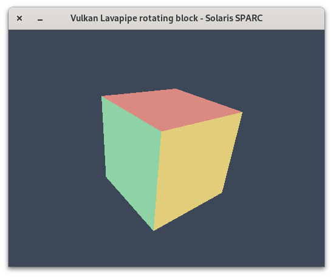
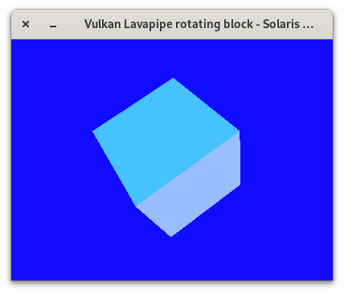

# Vulkan on Oracle Solaris — Lavapipe, Mesa, Shaderc and X11 WSI

**An experimental, side-by-side `/opt` Vulkan software-rendering toolchain for Oracle Solaris 11.4 on SPARCv9 and x86-64.**

Vulkan **can work on Solaris without GPU hardware acceleration**. The Khronos Vulkan loader discovers a Mesa **Lavapipe** installable client driver (ICD), which runs Vulkan rendering on the CPU using Gallium/LLVM. This project contains the Solaris source patches, build/install scripts, and a native X11 rotating-block demonstration. The SPARC T8-1 testing established that Lavapipe can render into a **real Vulkan Xlib swapchain**, even though the Solaris X server in that setup has **no DRI3 extension**.

> **Status / scope:** The loader, Mesa 21.3.8 with Lavapipe, and the demo were verified incrementally on an Oracle **SPARC T8-1**. Solaris **x86-64** build paths are included for porters, but are **not validated by the attached SPARC tests**. **ARM has not been tested.** No official NVIDIA proprietary Vulkan driver on x86 has been tested. Shaderc, optional glslang, and the clean-room all-in-one installer have not yet been end-to-end tested on either architecture; read [Validation](#validation-and-known-limitations).



*The screenshot uses `VK_FORMAT_B8G8R8A8_SRGB` (format 50): the softer/pastel colors are normal sRGB conversion. Prefer the advertised `VK_FORMAT_B8G8R8A8_UNORM` (format 44) for the demo's darker, unsaturated linear clear colors. The program in this repository prefers UNORM.*

## Overview: what gets built

| Component | Version | Default installation | Role / verified status |
| --- | --- | --- | --- |
| Vulkan-Headers + Vulkan-Loader | **1.3.250** | `/opt/vulkan-1.3.250` | Vulkan loader and header files; tested on SPARC |
| Oracle Solaris-patched Mesa | **21.3.8** | `/opt/mesa-lavapipe-21.3.8-wsi` | Lavapipe ICD, LLVMpipe/Softpipe, OpenGL, GLX, EGL, GLES, GBM; prior build validated on SPARC; new integrated installer experimental |
| Lavapipe WSI fixes | Mesa 21.3.8 patch set | Compiled into the above ICD | No-FD-export allocation fix and X11 big-endian pixel-order fix; both tested on SPARC |
| Shaderc | **2025.4** | `/opt/shaderc-2025.4` | `glslc`, `libshaderc_shared.so`, glslang + SPIRV-Tools dependencies; separate build recipe, not yet runtime verified |
| Vulkan rotating block | Included C application | `/opt/vk-rotating-block` | Vulkan 1.0/1.1/1.2 requests, offscreen readback, Xlib WSI/swapchain, X11 DRI3 probe; tested on SPARC |
| Standalone glslang (optional) | 13.1.1 | `/opt/glslang-13.1.1` | Optional development utility, **not part of default install**, build not verified |

The Shaderc source sync already fetches its own version-matched **glslang**, **SPIRV-Tools**, and **SPIRV-Headers**. An independent glslang install is optional, not required for the rotating demo. **GTK is not a Mesa build option**; GTK clients can use a working OpenGL/EGL stack through their own toolkit dependencies. This repository does not ship or silently replace Solaris's native Mesa or display server.

### How the pieces fit

```text
Vulkan program (C/C++, LWJGL, etc.)
                |
     libvulkan.so Vulkan Loader
        (/opt/vulkan-1.3.250)
                |
           Lavapipe ICD
   (/opt/mesa-lavapipe-21.3.8-wsi)
                |
      Gallium + LLVM / CPU
                |
     [a] offscreen RGBA8 -> CPU copy -> XPutImage -> X11
     [b] Xlib VkSurfaceKHR -> software Vulkan swapchain -> X11

Shader source (GLSL) -> glslc / libshaderc -> SPIR-V
                  (only when application needs shader compilation)
```

The included demo deliberately uses Vulkan clear-attachment and image-transfer commands rather than a shader/triangle rendering pipeline. That makes it a **Vulkan API + WSI functional test**, not a modern 3D Vulkan performance or conformance benchmark.

## Prerequisites

A 64-bit installation of **Oracle Solaris 11.4** with:

- GCC 15 (tested toolchain `/usr/gcc/15/bin/{gcc,g++}`), GNU make (`gmake`), `git`, `cmake`, `meson`, `ninja`, `pkg-config` and Python 3 (`python3`).
- LLVM 13 and its development libraries, tested at `/usr/llvm/13` and `/usr/llvm-13/include`.
- X11/XCB development headers and 64-bit libraries; Meson `pkg-config` modules including `x11`, `x11-xcb`, `xcb`, `xcb-dri3`, `xcb-present`, `xcb-randr`, `xcb-shm`, `xcb-sync`, `xcb-xfixes` and `xshmfence`. **The `xcb-dri3` development library being present does not mean the X server must advertise DRI3.**
- Oracle Solaris Userland's patched **Mesa 21.3.8** source (see below), rather than an unpatched generic Linux-oriented Mesa tarball.
- Internet access for Git source/dependency checkout (unless already cached).
- Sufficient disk space and patience for large C/C++ builds. 8 Ninja jobs worked for the original SPARC build.

The hard-coded compiler/LLVM directories reflect the tested machine. Adapt the scripts if your Solaris installation has different versions/locations. The installer is not an IPS package manager and does not resolve missing build dependencies for you.

### Obtain Oracle-patched Mesa source

The [Oracle Solaris Userland source repository](https://github.com/oracle/solaris-userland) contains Solaris build recipes and downstream patches. This repository's Mesa installer expects an **already prepared Userland checkout** at:

```text
/var/tmp/mesa-solaris-21.3.8-work/solaris-userland/
  components/x11/lib/mesa/
```

This matches the tested development machine. One way to prepare the layout is:

```bash
sudo mkdir -p /var/tmp/mesa-solaris-21.3.8-work
cd /var/tmp/mesa-solaris-21.3.8-work
sudo git clone https://github.com/oracle/solaris-userland.git

cd solaris-userland/components/x11/lib/mesa
# Reuse the original checkout's versioned 21.3.8 build recipe.
sudo gmake GCC_ROOT=/usr/gcc/15 PERL_VERSION=5.38 \
  PERL=/usr/bin/perl PYTHON_VERSION=3.11 download
sudo gmake GCC_ROOT=/usr/gcc/15 PERL_VERSION=5.38 \
  PERL=/usr/bin/perl PYTHON_VERSION=3.11 prep
```

**Version matters:** Solaris Userland's moving `master` may no longer carry Mesa 21.3.8. If so, use a historical checkout/revision containing the component, or provide a previously prepared **Oracle-patched Mesa 21.3.8** directory with `--source /path/to/mesa-21.3.8`. The installer checks for a `meson.build` in the supplied source. `gmake prep` must never inherit Mesa's standalone `-m64` flags, because Userland itself builds some 32-bit host utilities.

## Quick start

Extract the release ZIP or clone the repository. From the top-level project directory:

```bash
# 1. Inspect intended actions (requires a Solaris host but does not modify files)
sudo bash scripts/install-all.sh --dry-run

# 2. Build into /opt: headers/loader, Mesa OpenGL+Lavapipe, demo, Shaderc
sudo bash scripts/install-all.sh --all --jobs 8
```

The default Mesa destination is deliberately **`/opt/mesa-lavapipe-21.3.8-wsi`**, rather than the older experimental `/opt/mesa-lavapipe-21.3.8`. Existing prefixes are reused rather than overwritten. This avoids replacing a working driver without an explicit backup. It also uses a **separate Meson/Ninja build directory** (`build-mesa-lavapipe-x11-integrated`) so it does not reconfigure the older experimental build tree used in the successful test session. If an existing prefix was compiled *before* the WSI fixes, reusing it will also reuse its bugs; install into a new prefix and verify with `--wsi-probe`.

If you only want the known-working style of loader + Mesa + rotating block and don't need shader compilation:

```bash
sudo bash scripts/install-all.sh --core --jobs 8
```

If you already have matching Vulkan-Headers + loader installed:

```bash
sudo bash scripts/install-all.sh --mesa-only --jobs 8 \
  --source /path/to/oracle-patched/mesa-21.3.8
sudo bash scripts/install-all.sh --demo-only
```

Run the GUI application from the **desktop user's session without `sudo`**, keeping your normal X11 authorization:

```bash
export DISPLAY=:0
/opt/vk-rotating-block/bin/run.sh --api 1.2 --probe
/opt/vk-rotating-block/bin/run.sh --api 1.2 --wsi-probe
/opt/vk-rotating-block/bin/run.sh --api 1.2 --present wsi
```

Additional tests:

```bash
bash tests/smoke-test.sh
/opt/vk-rotating-block/bin/run.sh --api 1.1 --present readback
/opt/vk-rotating-block/bin/run.sh --api 1.2 --present auto
/opt/vk-rotating-block/bin/run.sh --dri3-probe
```

Press **Q** or **Escape** to exit. Add `--width 400 --height 300 --fps 10` for a lower rendering load. `--probe` tests a Vulkan CPU device without opening a window. `--present readback` uses Vulkan offscreen rendering plus XPutImage. `--present wsi` requires real Vulkan swapchain creation. `--present auto` falls back to readback if WSI setup fails.

### Test arbitrary Vulkan applications

To launch your own `vkcube` or other program with the `/opt` Vulkan loader and specific Lavapipe ICD:

```bash
bash scripts/launch-vulkan.sh /path/to/your/vulkan-program
```

You may also select a test ICD explicitly:

```bash
export VK_DRIVER_FILES=/path/to/test-lavapipe-icd.json
bash scripts/launch-vulkan.sh /opt/vk-rotating-block/bin/vk-rotating-block \
  --api 1.2 --present wsi
```

On this loader generation, `VK_DRIVER_FILES` takes priority over the older `VK_ICD_FILENAMES`. Both point to **ICD JSON manifests**, not to `libvulkan_lvp.so`. Setting these variables does not install or enable a kernel driver. Avoid sourcing the old experimental `lavapipe-env.sh` *after* setting a test ICD; it can overwrite `VK_ICD_FILENAMES`. The bundled `demo/run.sh` preserves an explicit selection. See [Khronos loader driver-discovery documentation](https://github.com/KhronosGroup/Vulkan-Loader/blob/main/docs/LoaderDriverInterface.md).

### Build standalone shader tools

Shaderc (included in `--all`) can also be built independently:

```bash
sudo bash scripts/install-shaderc.sh --configure-only
sudo bash scripts/install-shaderc.sh --build-only
/opt/shaderc-2025.4/bin/glslc --version
```

Optional independent glslang utilities:

```bash
sudo bash scripts/install-glslang-optional.sh
```

Optional Khronos Vulkan-Tools (`vkcube`, `vulkaninfo`) from source, if you also have an independent glslang build:

```bash
sudo bash scripts/install-vulkan-tools-optional.sh
bash scripts/launch-vulkan.sh /opt/vulkan-tools-1.3.250/bin/vkcube
```

This optional Vulkan-Tools builder is an **unverified porting recipe**; it may need additional Solaris-specific fixes. The bundled block demo is the verified X11 WSI test and does not require Vulkan-Tools.

**Caveat:** These Shaderc and optional glslang build recipes still need independent Solaris port validation. The repo provides pinned sources, builds and a smoke shader, but does not claim that every downstream library and application (especially native LWJGL modules for Minecraft) is already ported. Potential missing components include SPARC JNI/native LWJGL, GLFW, VMA and SPIRV-Cross. Vanilla Minecraft's OpenGL renderer does **not** require Shaderc merely because Vulkan is installed.

## The two Solaris WSI fixes

### 1. `VK_ERROR_OUT_OF_DEVICE_MEMORY (-2)` at `vkCreateSwapchainKHR`

Initial tests established that Vulkan 1.0/1.1/1.2 initialization, physical-device enumeration, ordinary RGBA image/buffer allocation, and offscreen rendering were functional, but direct Xlib WSI consistently failed at `vkCreateSwapchainKHR`:

```text
vkCreateXlibSurfaceKHR:                  0 (VK_SUCCESS)
vkGetPhysicalDeviceSurfaceSupportKHR:    0, present support=1
vkGetPhysicalDeviceSurfaceCapabilitiesKHR: 0
vkCreateSwapchainKHR:                   -2 (VK_ERROR_OUT_OF_DEVICE_MEMORY)
```

The tested Solaris X server advertised **Present** and **MIT-SHM**, but **not DRI3**. In Mesa 21.3.8's software X11 WSI path, a non-shared-memory software swapchain allocation unnecessarily chained an exportable FD request through `VkMemoryDedicatedAllocateInfo::pNext`. The experimental patch in [`patches/apply-wsi-no-fd.py`](patches/apply-wsi-no-fd.py) changes this one site in `src/vulkan/wsi/wsi_common_drm.c`:

```c
.pNext = (wsi->sw && alloc_shm == NULL)
       ? NULL : &memory_export_info,
```

The condition retains export behavior for the other allocation paths while allowing **software, non-SHM images** to use ordinary host-visible memory. After rebuilding just the Lavapipe target, the SPARC system reported:

```text
vkCreateSwapchainKHR: 0 (VK_SUCCESS)
WSI SUCCESS: Vulkan Xlib swapchain has 3 images, format 44.
```

This is a **confirmed working workaround for the tested path**, not a general claim that removing export handles is always correct for all Vulkan WSI implementations. It also does not make DRI3 appear on the X server. A no-DRI3 software fallback is sufficient for the tested setup.

### 2. Big-endian SPARC + X11 `MSBFirst` pixel colors

The initial WSI image displayed a neon-blue background and cyan/pale-blue cube faces, while the offscreen `XPutImage` fallback looked correct:



Investigation showed that the server's `xdpyinfo` reported:

```text
image byte order: MSBFirst
Vulkan surface formats: 50 (B8G8R8A8_SRGB), 44 (B8G8R8A8_UNORM)
```

For a BGRA8 Vulkan pixel in memory, the tested 32-bpp X11 software `xcb_put_image` path on `MSBFirst` effectively treated **alpha as blue**. [`patches/apply-wsi-msbfirst-colors.py`](patches/apply-wsi-msbfirst-colors.py) patches `src/vulkan/wsi/wsi_common_x11.c`, rewriting the **software X11 presentation function only** to pass a temporary byte-reordered copy from `[B,G,R,A]` to `[A,R,G,B]`:

```text
X11 MSBFirst / 32bpp only:
Vulkan bytes:       B G R A
XCB ZPixmap bytes:  A R G B
```

This preserves the Vulkan-owned source image and does not alter other Mesa presentation paths. Disable the experimental conversion with `MESA_SOLARIS_LVP_WSI_BYTESWAP=0` for before/after testing. The patch is conditional: **do not apply this permutation blindly on little-endian Solaris x86**, which normally has different X11 byte ordering. A more general upstream solution would also consider the X visual's masks, depth, and full pixel-format semantics.

The post-patch SPARC screenshot shows corrected channels. Format **50** then exhibited naturally lighter/pastel colors from *sRGB transfer conversion*: a linear background near `(11,17,24)` becomes displayed sRGB near `(60,72,87)`. Format **44** (UNORM) avoids that automatic transfer-function conversion; this demo prefers 44 where available.

### 3. Other Solaris build patches

The Mesa builder also incorporates:

- **Solaris `int8_t` signedness:** repair Mesa RGTC/LATC callers where Solaris's `int8_t` aliases `char` but helper signatures use `signed char`; GCC 15 rejected incompatible pointer/array types.
- **Direct X11/XCB Lavapipe link dependencies:** Solaris's linker could not resolve `xcb_randr_*`, `xcb_present_*`, `xcb_shm_*`, `xcb_sync_*`, `xshmfence_*`, `XGetXCBConnection` and base `xcb_*` from indirect DSOs. The installer adds explicit dependencies **only to `libvulkan_lvp.so`**.
- **Khronos loader Solaris paths:** add `__sun` to the UNIX platform definitions, POSIX extensions, and `/proc/self/path/a.out` executable lookup; use a C dispatch fallback for unsupported SPARC assembly. A separate loader/driver interface warning remains under investigation.
- **Solaris X11 + Gallium options:** `-Dplatforms=x11`, `-Dgallium-drivers=swrast`, `-Dvulkan-drivers=swrast`, `-Ddri3=enabled` for required build support, plus OpenGL/EGL/GLX/GLES/GBM. **Enabling the Mesa DRI3 build option is not the same as requiring the server DRI3 extension at runtime.**

The two WSI fixes are applied **before** configuring/building Mesa with [`scripts/install-mesa-lavapipe.sh`](scripts/install-mesa-lavapipe.sh). All source patchers are idempotent, preserve `.bak` files on first modification, and refuse to rewrite if expected anchors cannot be found. The repository also preserves the incremental `--build`/`--test` tools from the original successful experiment under [`legacy/`](legacy/README.md).

## Mesa 24, libdrm and the future NVK port

This package uses **Solaris Userland's Mesa 21.3.8 sources** because that branch has Solaris-specific integration and it was the version used for the confirmed SPARC X11 WSI experiments. The project author has **separately reported** getting newer **Mesa 24** to work using a Python-driven build/porting approach. The Python experiment, exact configuration, logs and patches are **not included here**, so we do not claim this ZIP independently reproduces the Mesa 24 result.

**Solaris's packaged `libdrm` version limits which newer Mesa DRM-based drivers and features can be built without updating/backporting interfaces.** That is not a universal version ceiling for Mesa or CPU software Vulkan: a newer Mesa may still build and run when optional unsupported hardware backends are disabled. More recent Mesa sources, including Mesa **24 or 25**, are therefore interesting follow-up targets.

The long-term roadmap includes investigating the open-source **NVK** Vulkan driver for NVIDIA hardware as part of Mesa 24/25 porting. This is **not a completed NVK port**: upstream NVK relies on the Linux Nouveau/DRM kernel interface (see [Mesa NVK documentation](https://docs.mesa3d.org/drivers/nvk.html)). Porting it to Solaris would involve substantial DRM/kernel/userspace compatibility work, buffer/device management, synchronization, ioctl semantics, and GPU firmware considerations—not simply compiling a shared library. On Solaris **x86**, official proprietary NVIDIA drivers have **not been tested by this project**. The only Vulkan ICD used for the demonstrated tests was **Lavapipe CPU rendering**. Any future hardware acceleration and OpenGL-over-Vulkan (Zink) are separate projects, not promised capabilities of this release.

## Validation and known limitations

See [`docs/TESTED-RESULTS.md`](docs/TESTED-RESULTS.md) for the precise successful terminal calls and [`legacy/README.md`](legacy/README.md) for the incremental scripts that led to the fixes. At the time of this release:

| Capability | SPARC T8-1 | Solaris x86-64 | ARM |
| --- | --- | --- | --- |
| Loader 1.3.250 / Vulkan-Headers | Verified | Build path provided, untested | Untested |
| Mesa 21.3.8 / Lavapipe ICD | Verified | Build path provided, untested | Untested |
| Vulkan 1.0, 1.1, 1.2 app-version probes | Passed basic probes | Untested | Untested |
| Xlib WSI with three-image swapchain | Verified after patch | Untested | Untested |
| Rendering/presenting directly to swapchain | Verified at ~12 FPS demo target | Untested | Untested |
| Correct BGRA channels in software X11 | Verified on 32bpp MSBFirst | Not needed as-is for LSBFirst; untested | Untested |
| Shaderc 2025.4 clean install | Not yet independently confirmed | Untested | Untested |
| Hardware Vulkan driver (NVIDIA/AMD/etc.) | Not tested | Not tested | Not tested |

**Loader warning:** The Solaris Lavapipe ICD reports a Vulkan 1.2.195 physical device but negotiates loader/driver interface **4**, while the 1.3.250 loader warns an interface **5+** is expected for Vulkan 1.1+. The tests still initialized and presented; this is **not** a statement of Khronos conformance or universal Vulkan 1.2 app compatibility. Investigate interface negotiation before calling this a production-ready driver.

**X11 session:** The demo sometimes logged `X connection to :0 broken (explicit kill or server shutdown)` when exiting; its origin was not established. Observe whether the X server is actually terminating if this recurs. The swapchain color fix and no-FD fix should be upstream-reviewed before production use; the color patch assumes 32-bit pixel storage for the tested path.

**x86/Solaris:** Architecture detection and `lib/amd64` paths are implemented, but compiler/LLVM/X11 dependency variability may require additional adjustments. Do not publish x86 as "verified" until an x86 machine runs the smoke tests. **ARM untested.**

**OpenGL 4.6 is not promised:** the older Mesa build previously reported llvmpipe OpenGL 3.1 and Softpipe OpenGL 3.3 in this SPARC environment; enabling OpenGL at configure time does not establish GL 4.6. Vulkan software rendering and OpenGL capability levels are independent.

## Troubleshooting

| Symptom | Check |
| --- | --- |
| `VK_ERROR_OUT_OF_DEVICE_MEMORY (-2)` at `vkCreateSwapchainKHR` | Ensure you're loading the newly built patched ICD, not the earlier `/opt/mesa-lavapipe-21.3.8` ICD; run `--wsi-probe` and inspect `VK_DRIVER_FILES` |
| Vulkan device succeeds, swapchain fails | Check `xcb` dependencies, applied `wsi_common_drm.c` patch, and current Mesa ICD manifest |
| Solid bright blue / cyan instead of correct colors | Check `xdpyinfo` `image byte order`, `B8G8R8A8` selection, and the conditional MSBFirst XCB conversion |
| DRI3 not in `xdpyinfo` | Expected on tested X server; software fallback works after patch. Do not assume DRI3 required by a software Vulkan swapchain |
| Pastel colors | Swapchain picked `VK_FORMAT_B8G8R8A8_SRGB` (50); prefer `B8G8R8A8_UNORM` (44) for original demo appearance |
| `loader interface version 4` warning | Compatibility warning separate from the confirmed no-FD and color bugs; do not hide warning in test logs |
| `libxcb`/`libxshmfence` undefined symbols at link | Confirm required Solaris 64-bit `pkg-config` metadata and the explicit Mesa Lavapipe direct-link patch |
| `int8_t` incompatible pointers (RGTC/LATC) | Confirm the installer ran the source compatibility patch before Ninja |
| `run.sh` unexpectedly uses old driver | Use `VK_DRIVER_FILES=/absolute/path/to/icd.json` or `scripts/launch-vulkan.sh`; explicit manifest overrides are preserved |
| Missing shader `glslc` | Shaderc is separate from Vulkan ICD; build with `--shaderc-only` and read CMake logs |

### References

- [Oracle Solaris Userland](https://github.com/oracle/solaris-userland) — Solaris package source/patch infrastructure
- [Mesa 3D Graphics Library](https://docs.mesa3d.org/) — Gallium, Mesa, Lavapipe, NVK
- [Mesa NVK driver and Linux kernel requirements](https://docs.mesa3d.org/drivers/nvk.html)
- [Khronos Vulkan-Loader](https://github.com/KhronosGroup/Vulkan-Loader)
- [Khronos Vulkan loader driver discovery](https://github.com/KhronosGroup/Vulkan-Loader/blob/main/docs/LoaderDriverInterface.md)
- [Shaderc](https://github.com/google/shaderc)
- [Vulkan API specification](https://registry.khronos.org/vulkan/specs/latest/html/vkspec.html)

## Repository layout

```text
scripts/install-all.sh                  unified /opt installation (core + Shaderc)
scripts/install-vulkan-loader.sh        Vulkan-Headers and Vulkan Loader 1.3.250
scripts/install-mesa-lavapipe.sh        Mesa OpenGL + Lavapipe with both WSI patches
scripts/install-shaderc.sh             Shaderc 2025.4 and dependency checkout
scripts/install-glslang-optional.sh    optional independent glslang CLI
scripts/install-vulkan-tools-optional.sh  optional vkcube/vulkaninfo from source
scripts/launch-vulkan.sh              isolated ICD/loader launcher
patches/apply-rgtc.py                  Solaris GCC int8_t helper fix
patches/apply-lavapipe-x11-link.py      direct XCB linkage for Solaris ld
patches/apply-vulkan-loader-solaris.py SunOS Vulkan loader port
patches/apply-wsi-no-fd.py             tested software WSI allocation fix
patches/apply-wsi-msbfirst-colors.py   tested software X11 byte-order fix
demo/src/vk_rotating_block.c           native Vulkan block demo source
demo/build.sh / run.sh / test-modes.sh  demo installation and invocation
tests/smoke-test.sh                    basic tests
docs/TESTED-RESULTS.md                 recorded SPARC evidence
docs/screenshots/                      real X11 screenshots
legacy/                                older full installer and WSI test scripts
```

## Contributing and tests

Run `python3 tests/test_patchers.py` and `bash -n scripts/*.sh` (use the CI workflow for all scripts) to check patch targeting and shell parsing without Solaris. Real Vulkan functional validation still requires Solaris hardware; PRs should include `uname -p`, the Mesa checkout revision, loader and ICD versions, `xdpyinfo` byte order/extensions, and the `--wsi-probe` result.

## Licensing

The repository's **original wrapper/build scripts and demo** are MIT-licensed (see [`LICENSE`](LICENSE)). It contains small source transformations for upstream projects; Vulkan-Loader, Mesa and Shaderc source fetched at build time retain **their own upstream licenses**. The ZIP does not vendor their complete source trees or compiled runtime libraries. Preserve notices and comply with the appropriate upstream terms when redistributing patched binaries.
